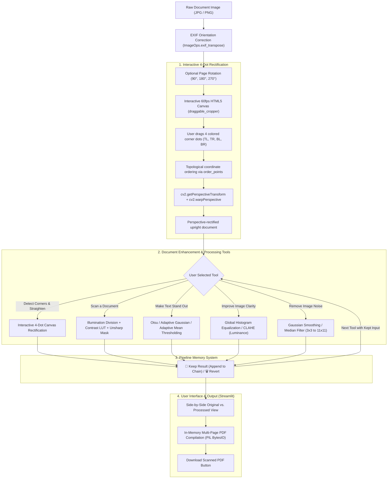

# 📄 Scanify — IPCV Document Scanner & Image Enhancement Suite

An interactive Computer Vision document scanner and image enhancement system built with **Python**, **OpenCV**, and **Streamlit**. Designed and aligned with the college **Image Processing and Computer Vision (IPCV)** curriculum.

---

## 📌 Table of Contents
1. [Project Overview & Objectives](#-project-overview--objectives)
2. [Features & IPCV Syllabus Mapping](#-features--ipcv-syllabus-mapping)
3. [Algorithms Used & Simple Explanations](#-algorithms-used--simple-explanations)
4. [System Workflow & Flowchart](#-system-workflow--flowchart)
5. [Four-Member Contribution Table](#-four-member-contribution-table)
6. [Installation & Run Instructions](#-installation--run-instructions)
7. [Test Cases, Limitations & Future Scope](#-test-cases-limitations--future-scope)
8. [Project Directory Structure](#-project-directory-structure)

---

## 🎯 Project Overview & Objectives

### Context & Motivation
Capturing documents using smartphone cameras is standard practice, but mobile captures frequently suffer from:
* **Perspective distortion**: Handheld camera angles skew rectangular pages into arbitrary quadrilaterals.
* **Non-uniform illumination**: Shadows cast by hands/devices and harsh flash hotspots ruin legibility.
* **Sensor & compression noise**: High ISO settings in dim lighting introduce grain and impulse artifacts.
* **Low contrast & faded ink**: Old receipts, handwritten notes, and aged printed pages have poor figure-ground separation.

### Core Objectives
1. **Interactive Document Rectification**: Enable users to position four draggable corner dots directly on skewed mobile photos and compute a 2D homography transformation to project angled sheets into flat, top-down rectangular views.
2. **Noise Reduction with Edge Preservation**: Provide linear (Gaussian) and non-linear order-statistic (Median) filters to eliminate noise without degrading sharp character strokes.
3. **Adaptive Contrast & Lighting Normalization**: Separate foreground ink from background paper using global (Otsu) and localized (Adaptive Gaussian/Mean) thresholding, alongside Global and Tiled (CLAHE) Histogram Equalization.
4. **Pipeline State Memory**: Allow users to chain multiple processing steps (Straighten ➔ Noise Filter ➔ Thresholding ➔ Contrast Enhancement) with "Keep This Result" and "Remove / Revert" without losing previous operations.
5. **Interactive Laboratory Dashboard**: Present a clean, user-friendly Streamlit interface with non-technical tool naming, side-by-side comparison, and direct multi-page PDF generation.

---

## 📚 Features & IPCV Syllabus Mapping

| IPCV Syllabus Unit | Theoretical Topics Covered | Scanify Implementation & Feature |
| :--- | :--- | :--- |
| **Unit I: Image Acquisition, Sampling & Coordinate Relationships** | • Digital image representation<br>• Pixel relationships & connectivity<br>• Spatial coordinate transformations<br>• Projective geometry & 2D homography | • EXIF orientation matrix alignment (`ImageOps.exif_transpose`)<br>• 4-corner spatial topological ordering (`order_points`)<br>• Lossless orthogonal and affine rotation (90°, 180°, 270°)<br>• Interactive draggable 4-dot crop canvas & Perspective Homography rectification (`crop_and_straighten`) |
| **Unit II: Image Enhancement, Histogram Processing & Noise Filtering** | • Spatial convolution & averaging<br>• Median order-statistic filtering<br>• Global Histogram Equalization<br>• Adaptive Equalization (CLAHE)<br>• Illumination normalization<br>• Unsharp masking & high-boost sharpening | • Gaussian linear smoothing with dynamic kernels ($3 \times 3$ to $11 \times 11$)<br>• Non-linear median filter for salt-and-pepper noise removal<br>• Discrete 256-bin intensity histogram generation (`compute_grayscale_histogram`)<br>• Cumulative Distribution Function (CDF) equalization<br>• Chroma preservation via luminance equalizing in YCrCb/LAB<br>• Morphological background division and unsharp mask sharpening |
| **Unit III: Thresholding & Binarization** | • Global optimal thresholding<br>• Local adaptive thresholding<br>• Between-class variance optimization<br>• Foreground/background binarization | • Otsu's algorithm maximizing between-class variance ($\sigma_B^2$)<br>• Adaptive Gaussian-weighted local neighborhood thresholding<br>• Adaptive Arithmetic Mean local thresholding<br>• Channel-invariant pipeline integration (`ensure_bgr`) |

---

## 🔬 Algorithms Used & Simple Explanations

### 1. Interactive Four-Point Perspective Homography Transform (Unit I)
* **What it does**: Straightens an angled, tilted photograph of a document into a flat, top-down scan using 4 user-placed corner points.
* **How it works**: The document is displayed on the screen with four draggable points representing its corners: top-left, top-right, bottom-left, and bottom-right. The user can move these points to align them with the actual corners of the document. Once the corners are selected, the application applies a perspective transformation using OpenCV to correct the tilt and convert the document into a straight, rectangular image. This makes the document appear as if it were scanned directly from the front, improving its alignment and readability. The process also works when the document and its background have similar colors, as long as the corners can be identified correctly
* **Corner Ordering (`order_points`)**:
  Before computing $\mathbf{H}$, the 4 draggable corner coordinates are assigned topological roles:
  - $\text{Top-Left} (TL)$: Minimum sum $(x + y)$
  - $\text{Bottom-Right} (BR)$: Maximum sum $(x + y)$
  - $\text{Top-Right} (TR)$: Minimum difference $(x - y)$
  - $\text{Bottom-Left} (BL)$: Maximum difference $(x - y)$
* The width and height of the corrected page are determined using the Euclidean $L_2$ norm between corresponding corner coordinates.

---

### 2. Gaussian Smoothing vs. Median Filtering (Unit II)
* **Gaussian Filter (Linear Smoothing)**:
  * **Intuition**: Blurs the image gently by calculating a weighted average of neighbor pixels, where closer pixels have higher weights following a 2D Gaussian distribution.
  * **Best for**: Smooth sensor noise and subtle camera grain.
* **Median Filter (Non-linear Order-Statistics)**:
  * **Intuition**: Slides a window over the image, sorts all pixels numerically, and picks the exact middle (median) value.
  * **Best for**: Salt-and-pepper noise and speckles. Because impulse noise values ($0$ or $255$) are statistical outliers, they never become the median; text edges remain razor sharp.

---

### 3. Histogram Equalization: Global vs. CLAHE (Unit II)
* **Global Histogram Equalization**:
  * **Intuition**: Spreads out frequent intensity values across the entire $0$ to $255$ scale using the Cumulative Distribution Function (CDF).
  * **Color Preservation**: On color documents, equalization is executed only on the **Luminance channel** ($Y$ in YCrCb or $L$ in LAB) rather than independently on RGB, preserving chromaticity without color shifts.
* **CLAHE (Contrast Limited Adaptive Histogram Equalization)**:
  * **Intuition**: Global equalization can over-amplify noise in uniform areas (like blank paper margins). CLAHE divides the image into an $8 \times 8$ grid of tiles, clips histogram peaks exceeding a `clipLimit`, and smooths tile boundaries using bilinear interpolation.

---

### 4. Thresholding: Otsu vs. Adaptive (Unit III)
* **Otsu’s Global Optimal Thresholding**:
  * **Intuition**: Automatically finds a single cutoff value that cleanly separates foreground ink from background paper by maximizing the separation (variance) between the two groups.
    where $\omega_0, \omega_1$ are probabilities of background and foreground classes, and $\mu_0, \mu_1$ are their means.
* **Adaptive Thresholding (Gaussian & Mean)**:
  * **Intuition**: When an image has harsh shadows (e.g., hand or phone shadow), a single global threshold fails. Adaptive thresholding calculates a distinct threshold for every pixel based on its local $(B \times B)$ window minus constant $C$.
  * **Formula**:
    $$T(x, y) = \text{LocalAverage}(x, y) - C$$

---

## 🔄 System Workflow & Flowchart



---

## 👥 Four-Member Contribution Table

| Member | Assigned Role | IPCV Syllabus Unit | Concrete Contributions & Module Files |
| :--- | :--- | :--- | :--- |
| **Member 1** | **Noise Filtering & Smoothing Specialist** | **Unit II** | • Implemented linear spatial Gaussian smoothing (`cv2.GaussianBlur`)<br>• Implemented non-linear order-statistic median filtering (`cv2.medianBlur`)<br>• Designed dynamic aperture kernel controls ($3 \times 3$ to $11 \times 11$)<br>• Authored noise attenuation comparative analysis in [`processing.py`](file:///c:/Users/hp/OneDrive/Desktop/Project/Section-C_Team_Number-15/processing.py) |
| **Member 2** | **Perspective Homography & Thresholding Specialist** | **Unit I & III** | • Engineered interactive 4-corner draggable rectification component (`draggable_cropper`)<br>• Created topological 4-point coordinate ordering algorithm (`order_points`)<br>• Implemented 2D perspective homography rectification (`crop_and_straighten`)<br>• Implemented global Otsu thresholding and localized Adaptive Gaussian/Mean thresholding |
| **Member 3** | **Histogram & Enhancement Specialist** | **Unit II** | • Implemented 256-bin discrete intensity histogram generation (`compute_grayscale_histogram`)<br>• Built Global Histogram Equalization preserving chromaticity via YCrCb/LAB<br>• Integrated Contrast Limited Adaptive Histogram Equalization (CLAHE) |
| **Member 4** | **UI/UX, Integration & Pipeline Lead** | **Unit I, II, III** | • Architected Streamlit web application with beginner-friendly tools in [`main.py`](file:///c:/Users/hp/OneDrive/Desktop/Project/Section-C_Team_Number-15/main.py)<br>• Implemented sequential pipeline memory system (Keep & Revert stack) for multi-tool chaining<br>• Built channel invariance architecture (`ensure_bgr`) preventing pipeline channel errors<br>• Built multi-page in-memory PDF synthesis engine (`BytesIO`) |

---

## 🚀 Installation & Run Instructions

### Prerequisites
* Python 3.10, 3.11, or 3.12 (or 3.14)
* Python packages installed: `streamlit`, `opencv-python`, `numpy`, `pillow`.

### Step 1: Open Terminal & Navigate to Project
```powershell
Set-Location "c:\Users\hp\OneDrive\Desktop\Project\Section-C_Team_Number-15"
```

### Step 2: Run the Streamlit Application
```powershell
python -m streamlit run main.py
```
Streamlit will launch the web server and open `http://localhost:8501` automatically in your browser.

---

## 🧪 Test Cases, Limitations & Future Scope

### Evaluated Test Cases

| Test Case | Input Characteristics | Applied Tool | Expected & Observed Result |
| :--- | :--- | :--- | :--- |
| **TC-01: Tilted Document Photo** | Page captured at an oblique angle on a table surface. | **Detect Corners & Straighten** | User drags 4 corner dots to document corners; perspective homography flattens the page into a crisp rectangular scan. |
| **TC-02: Uneven Shadow** | Document photographed under handheld phone shadow / desk lamp gradient. | **Make Text Stand Out** *(Adaptive Gaussian)* | Local neighborhood thresholding successfully isolates text characters in shadowed regions where global thresholding failed. |
| **TC-03: Faded Printed Receipt** | Low dynamic range thermal receipt with weak ink contrast. | **Improve Image Clarity** *(CLAHE)* | Restores character readability and deepens text intensity without blowing out the light background paper. |
| **TC-04: Grainy Low-Light Photo** | High-ISO camera capture with severe salt-and-pepper noise. | **Remove Image Noise** *(Median Filter)* | Eliminates isolated white and dark noise pixels completely while preserving fine stroke boundaries. |
| **TC-05: Multi-page Batch Upload** | Multiple document captures. | **All Tools + Pipeline Memory + Download PDF** | Allows chaining tools per page with "Keep This Result", then compiles all pages in-memory into `scanned_document.pdf`. |

### Known Limitations
1. **Curled or Folded Paper**: Perspective homography assumes a strictly planar (flat) 2D surface. Highly crumpled pages or open thick books with curved spines exhibit non-linear distortions that planar homography cannot fully rectify.
2. **Severe Motion Blur**: Images with extreme camera shake lose high-frequency gradient information required for text sharpening.

### Future Scope
1. **Optical Character Recognition (OCR)**: Integrate Tesseract or lightweight CRNN models to embed searchable text directly into the compiled output PDF.
2. **Non-Planar Surface Unwarping**: Implement Thin-Plate Spline (TPS) or cylindrical mesh deformation models to flatten curved pages from thick open books.
3. **Automated Illumination Decomposition**: Use Retinex theory or intrinsic image decomposition to separate reflectance from shading maps for shadow removal.

---

## 📦 Project Directory Structure

```
Section-C_Team_Number-15/
├── .gitignore                                 # Git ignore file
├── cropper_component.py                       # Streamlit wrapper for interactive 4-dot cropper
├── draggable_cropper/                         # Custom HTML5 canvas component for 4-dot dragging
│   └── index.html                             # 60fps interactive canvas with touch/mouse handles
├── image/                                     # Sample document images
├── main.py                                    # Streamlit web application & UI pipeline
├── processing.py                              # Core IPCV algorithms (homography, filters, CLAHE, ensure_bgr)
├── README.md                                  # Comprehensive documentation & IPCV mapping
├── Scanify_Presentation (1).pptx              # Project slide deck
└── Scanify_Simple_Project_Report (1).docx     # Project documentation report
```
